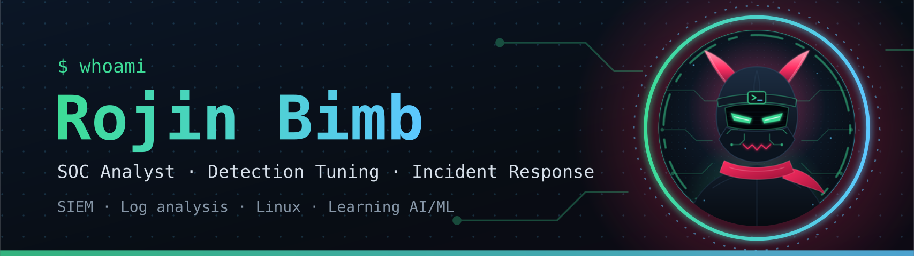

<div align="center">



<br />

[](https://rojinbimb.com.np)
[](https://www.linkedin.com/in/rojin-bimb-9136ba251/)


</div>


```bash
$ whoami
rojin — SOC analyst, blue-teamer, self-hosting tinkerer

$ cat focus.txt
SIEM detection engineering · log analysis · incident triage

$ ./currently --learning
data science · AI · ML
```

## 🧰 Toolbox

**SIEM**


**EDR**


**Systems and infrastructure**


**Workflow**


## 🔭 Currently

- 🌱 Learning **data science, AI, and ML**, with an eye on applying them to security analytics
- 🔒 Running a **security-first portfolio** at [rojinbimb.com.np](https://rojinbimb.com.np): static Astro build, strict Content Security Policy, zero client-side JavaScript, automated CI/CD
- 🖥️ Tinkering with my self-hosted VPS: containers, reverse proxies, and hardening


## 📈 GitHub stats

<div align="center">

<a href="https://github.com/RojinBimb">
  
</a>

</div>


## 🔗 Let's connect

The best way to reach me is through my website's contact page, or on LinkedIn.

<div align="center">

[](https://rojinbimb.com.np)
[](https://www.linkedin.com/in/rojin-bimb-9136ba251/)

<sub>Detect. Investigate. Escalate. Repeat.</sub>

</div>
